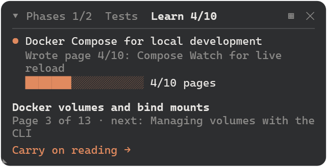
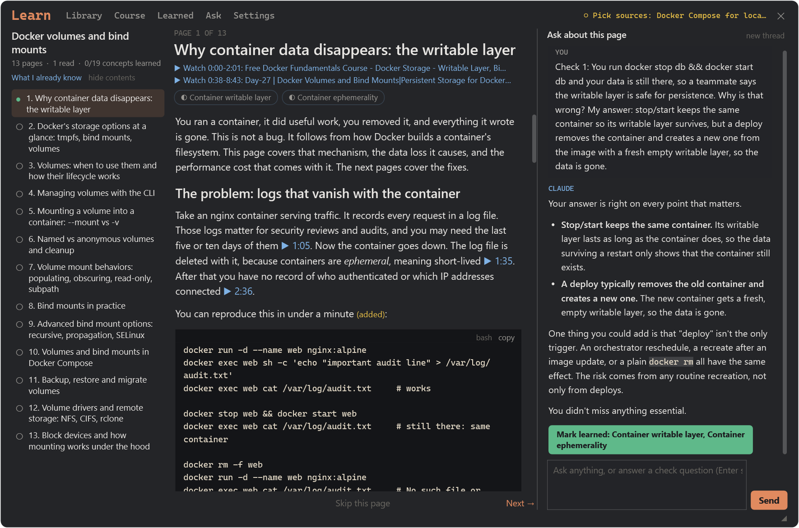
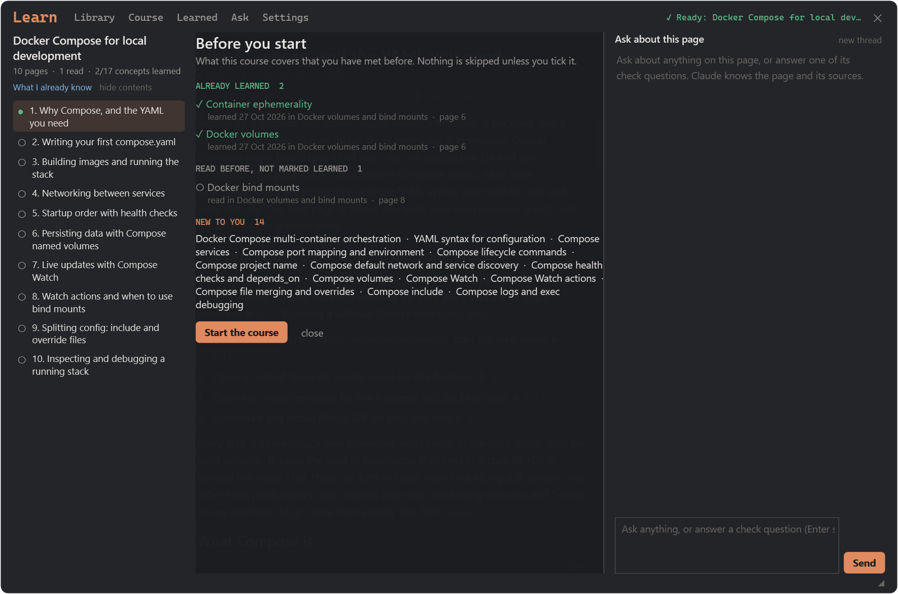
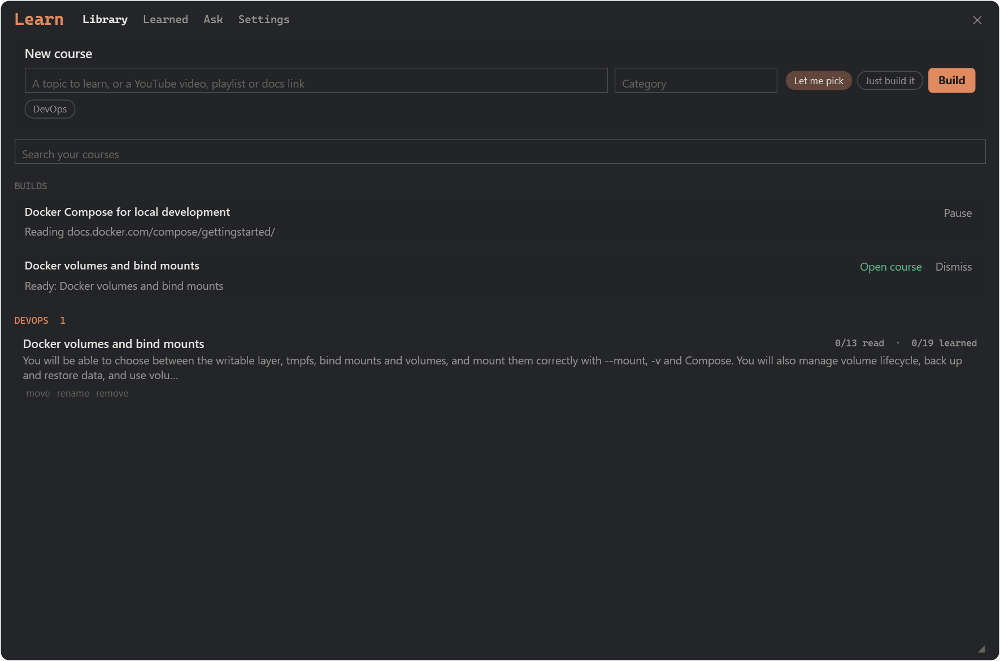
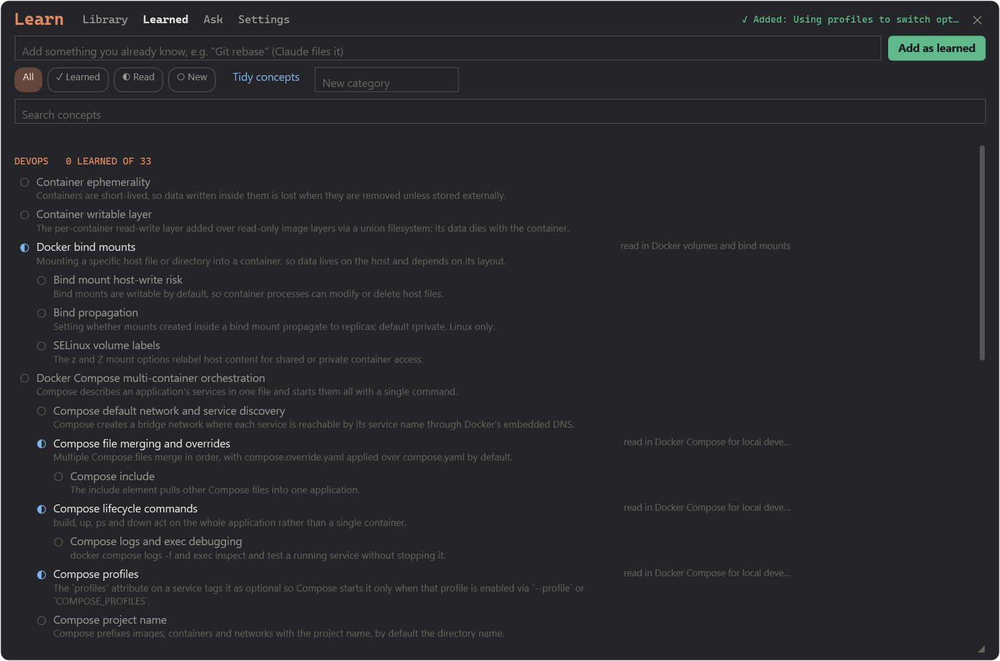

# claude-panel

A Claude Code plugin that puts a small floating panel over your terminal, showing what Claude is doing while it works:

- **Phases.** For any job with 3 or more steps, Claude lists the phases and ticks them off (done / now / next).
- **Tests.** A live count and bar while a test suite runs. The last few runs stay listed, with a total.
- **Learn.** Type a topic and your own Claude finds free videos and docs, reads them, and writes you a course: full pages, each with a Claude chat beside it. It tracks what you've learned across courses and tells you what's new.
- **Games (▦).** Sudoku, 2048, a Monkeytype-style typing test, and chess puzzles explained move by move, for while Claude is busy.

<p>
  
</p>

| A course page, with its chat | What you already know, before a new course |
|---|---|
|  |  |
| **Library** | **Learned** |
|  |  |

## This is my own setup

I built this for **my** machine, and it's only been run there:

- **Windows 10/11**
- **Claude Code inside WSL2** (Ubuntu)
- **WezTerm** as the terminal

The panel and the Learn window are Windows PowerShell 5.1 + WPF windows. They find the chat's WezTerm window and sit over it, and they reach into WSL through `\\wsl.localhost`. On any other setup, parts of this work and parts don't. The next section says which, and how to close the gap.

## What works where

| Your setup | Works today | Missing |
|---|---|---|
| **Windows + WSL2 + WezTerm** | Everything. | – |
| **Windows + WSL2 + another terminal** (Windows Terminal, VS Code) | The phases tool and test tracking, written to a state file. The Learn window and the games, opened with one command (below). | The floating panel. It looks for WezTerm. |
| **Windows, Claude Code in PowerShell** (no WSL) | The plugin loads and stays out of the way. | The panel, Learn and the games: they all go through WSL. |
| **macOS** | The phases tool and test tracking (test tracking needs `bash` as your `$SHELL`). Learn's helper from the command line: it builds courses into `~/.claude/learn`. | Any window: no panel, no Learn reader, no games. |
| **Linux / plain bash** | Same as macOS. | Same as macOS. |

The missing pieces are front ends; the core is shared. Claude writes everything the panel shows to one JSON file, and Learn runs behind a small JSON-lines helper. A new panel or a new Learn window for your setup only has to read that file or talk to that helper. [CLAUDE.md](CLAUDE.md) spells out both contracts and has a recipe for each platform. That's what your Claude reads when you ask it to port.

## Let your Claude set it up (any setup)

Paste this into Claude Code:

> Read the GitHub repo **YousifAbuzuhaira/claude-panel**: its README.md and CLAUDE.md. Check my OS, terminal and shell. Install the plugin if it fits my setup, tell me which parts will work for me, and offer to build the missing parts for my setup following CLAUDE.md's porting recipes.

How your Claude reads the repo:

- **With a GitHub MCP connected** (for example [github-mcp-server](https://github.com/github/github-mcp-server)), it reads the files directly.
- **Without one**, it clones the repo with `gh repo clone YousifAbuzuhaira/claude-panel`, or `git clone`.

The repo is **private**. Ask me (Yousif) to add you as a collaborator, then sign in with `gh auth login`.

## Install (Windows + WSL2 + WezTerm)

In WSL:

```bash
claude plugin marketplace add YousifAbuzuhaira/claude-panel
claude plugin install progress@claude-panel
```

Then in a Claude Code session: `/reload-plugins`, then `/phases`. The panel opens over your WezTerm window.

**Needs:**

- Windows PowerShell 5.1, which comes with Windows.
- For Learn:
  - **Node 22+** inside WSL;
  - **Claude Code logged in** (`claude` on your PATH);
  - optionally `python3`, which lets Learn use the small yt-dlp build.

**Update:** `claude plugin marketplace update claude-panel`, then `/reload-plugins`.

### Windows + WSL2 with another terminal

Install the same way. The panel won't appear, because it looks for WezTerm, but you can open Learn and the games yourself. First, find where the plugin lives:

```bash
claude plugin list            # note the "Read from:" path of progress@claude-panel
P=<that path>
powershell.exe -NoProfile -ExecutionPolicy Bypass -File "$(wslpath -w "$P/widget/Learn.ps1")"
```

Swap `Learn.ps1` for `ChessPuzzles.ps1`, `Sudoku.ps1`, `Game2048.ps1` or `TypeTest.ps1` for a game.

### macOS / Linux

Install with the two commands above. Claude gets the phases tool, and the state file at `/tmp/claude-progress/<session>/phases.json` fills as it works. Learn's helper runs on its own:

```bash
P=<the "Read from:" path from claude plugin list>
bash "$P/learn/learn.sh" build start --topic "Kubernetes deployments" --category DevOps --mode auto
bash "$P/learn/learn.sh" build list
```

Courses land in `~/.claude/learn/courses/<id>/pages/*.json`, with the lesson in each page's `markdown` field. A reader window is the thing to build: see CLAUDE.md.

## Using it

- **Phases.** Nothing to do: the plugin tells Claude to use its `phases_write` tool for any job with 3 or more steps. `/phases` opens the panel by hand; `/phases clear` empties it.
- **Tests.** When Claude runs a test command (vitest, jest, playwright, `node --test`, pnpm/npm/yarn/bun/turbo test scripts), the Tests tab fills in live.
- **The panel.** Drag it anywhere, resize it from the corner grip, collapse it with the arrow, close it with ✕.
- **Learn.** Use the panel's Learn tab, then *Open Learn*.
  - **Library:** type a topic or paste a YouTube, playlist or docs link. Choose *Let me pick* to tick the sources yourself, or *Just build it*. Builds run in the background: close the window and they carry on.
  - **Course:** contents, the lesson, and a chat that knows the page. ▶ times jump to that moment in the video, and *(added)* marks what Claude added beyond the sources. Answer the check questions in the chat. Nothing becomes *Learned* unless you mark it.
  - **Editing a course:** rename, reorder, rewrite (with a note) or remove a page; *+ Add a page* on any topic.
  - **Before a new course:** it shows what you've already learned, what you've only read, and what's new, and offers to skip pages.
  - **Learned:** every concept, by category. Add, rename, edit, nest, merge or remove concepts; *Tidy concepts* finds duplicates.
  - **Ask:** "what should I learn next?" Add your work folders in Settings and it suggests topics from the stack you really use, each with a *Build this* button.
  - **Settings:** the library folder, which Claude model builds courses and which one chats, and text size.
  - **Cost:** Learn runs on **your own Claude subscription** through `claude -p`, so it counts toward the same limits as your work. Settings shows the latest reading.
- **Games.** ▦ in the panel's header. Each game is its own window and saves after every move.

Where things are kept:

- `%LOCALAPPDATA%\ClaudePhases\` holds the windows' places and the games' saves.
- `~/.claude/learn` holds the Learn library; you can change it in Settings.
- `~/.config/claude-learn/` holds Learn's settings.

## Third-party data and tools

- **Chess puzzles:** the [Lichess puzzle database](https://database.lichess.org/#puzzles) (CC0), sampled by `progress/tools/build-puzzles.mjs`.
- **Chess pieces:** *cburnett* by Colin M.L. Burnett (GPLv2+), converted by `progress/tools/build-pieces.mjs`.
- **Typing test:** Monkeytype's English word list and themes ([monkeytype](https://github.com/monkeytypegame/monkeytype), GPL-3.0).
- **Downloaded at run time, never committed:**
  - [Stockfish](https://stockfishchess.org/) (GPLv3), pinned by checksum;
  - [yt-dlp](https://github.com/yt-dlp/yt-dlp) (Unlicense), checked against its release checksums.
