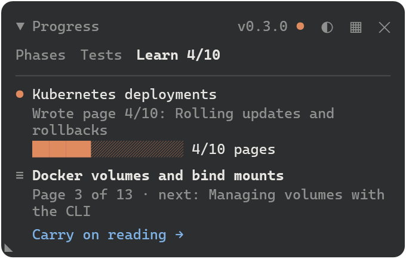
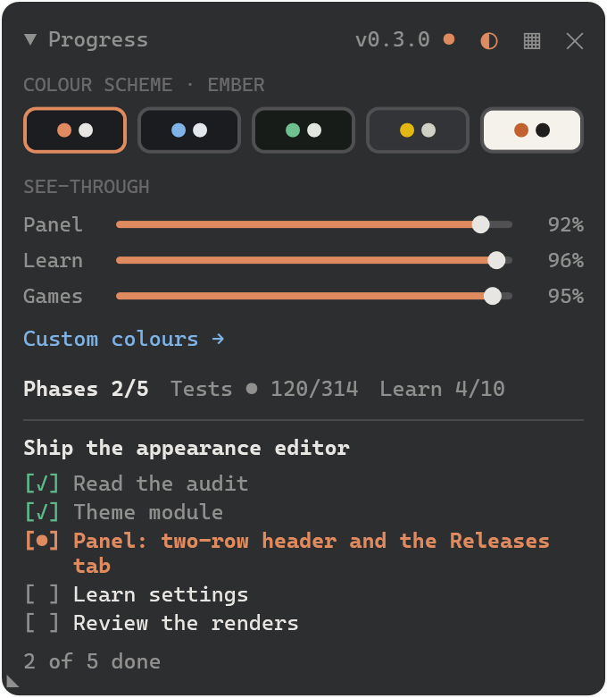
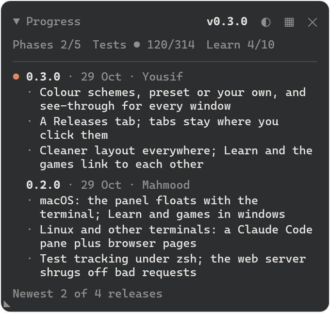
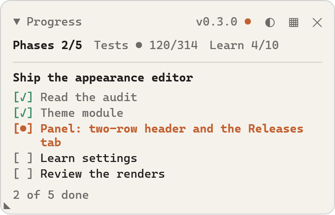
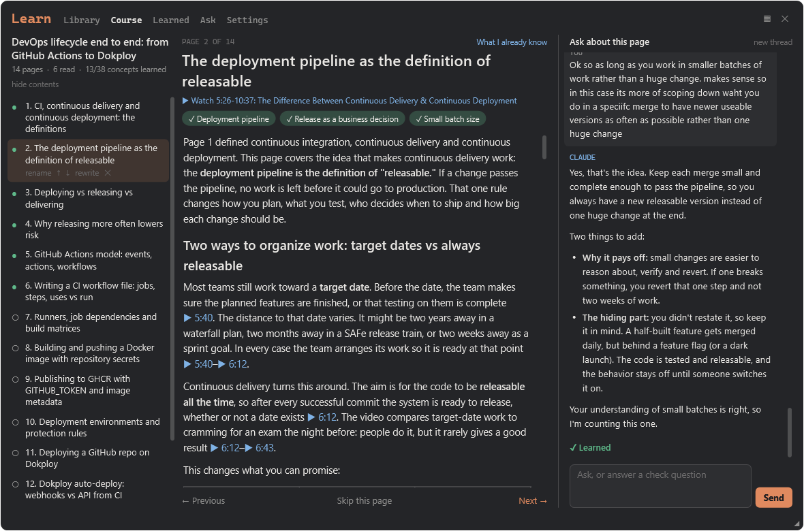
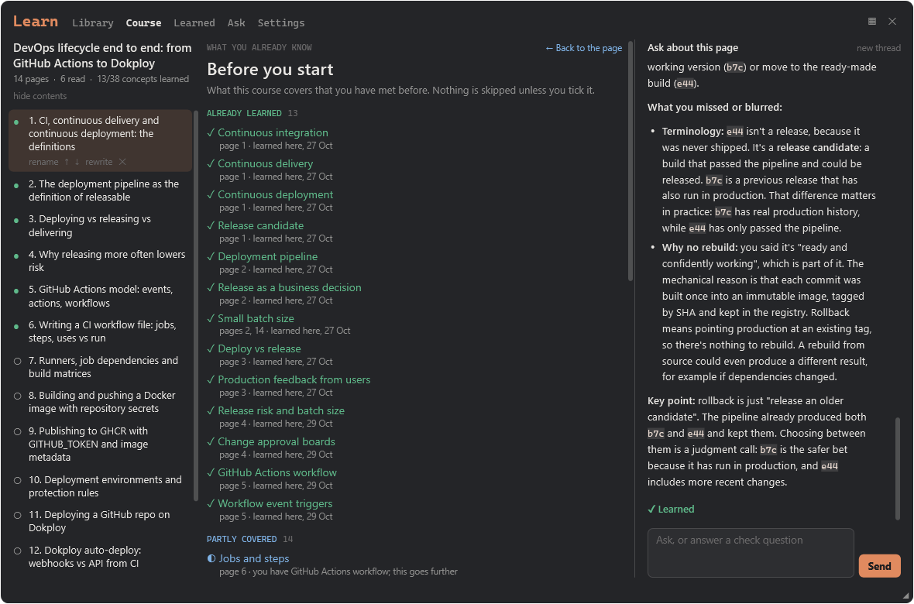
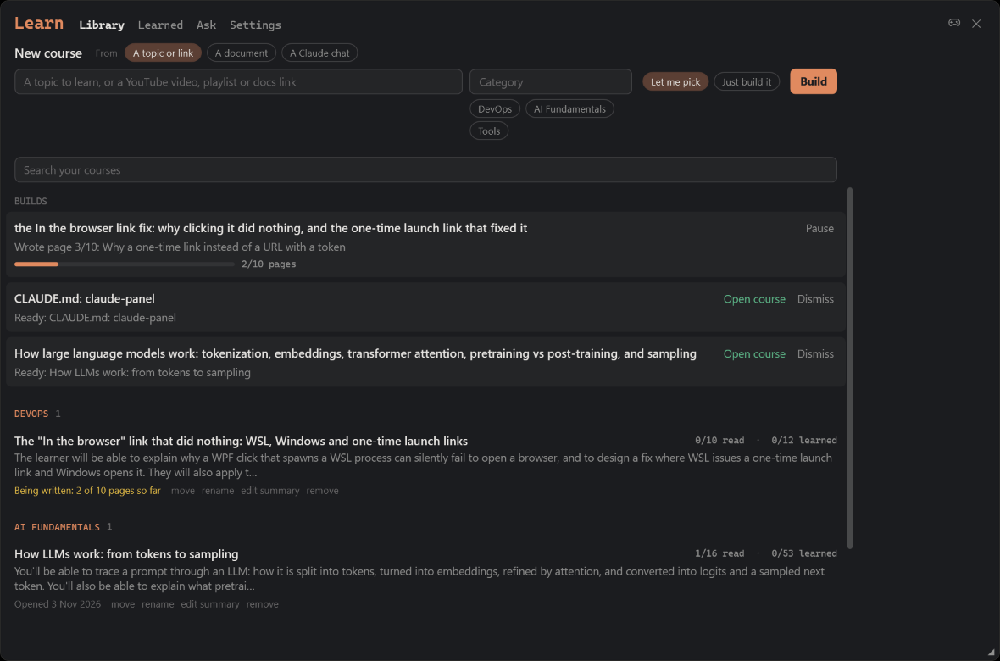
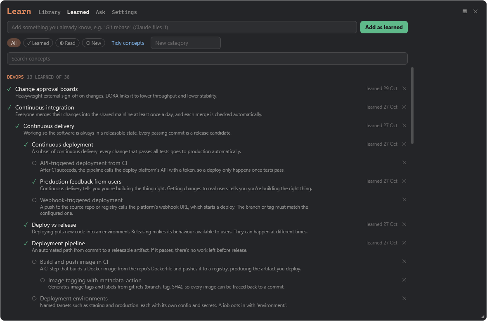

# claude-panel

A Claude Code plugin that puts a small floating panel over your terminal, showing what Claude is doing while it works:

- **Phases.** For any job with 3 or more steps, Claude lists the phases and ticks them off (done / now / next).
- **Tests.** A live count and bar while a test suite runs. The last few runs stay listed, with a total.
- **Learn.** Type a topic and your own Claude finds free videos and docs, reads them, and writes you a course: full pages, each with a Claude chat beside it. Terms explain themselves on hover, every idea gets a worked example, quick checks sit between sections, and a Review tab brings questions back over days. A concept counts as learned once you've explained it to Claude. It tracks what you've learned across courses and tells you what's new.
- **Games (▦).** Sudoku, 2048, a Monkeytype-style typing test, and chess puzzles explained move by move, for while Claude is busy.
- **Releases.** What changed in each version, who made it, in a line or two.
- **Your look.** Pick a colour scheme (Ember, Graphite, Moss, Serika, Paper, or your own three colours) and how see-through each window's background is. Every window follows at once.

<p>
  
  
  
  
</p>

| A course page, with its chat | What you already know, before a new course |
|---|---|
|  |  |
| **Library** | **Learned** |
|  |  |

## This is my own setup

I built this for **my** machine, and it's only been run there:

- **Windows 10/11**
- **Claude Code inside WSL2** (Ubuntu)
- **WezTerm** as the terminal

The panel and the Learn window are Windows PowerShell 5.1 + WPF windows. They find the chat's WezTerm window and sit over it, and they reach into WSL through `\\wsl.localhost`. Mahmood built the macOS side (a native floating panel and windows); anywhere else the panel is a Claude Code pane and Learn and the games open in the browser. The next sections say what works where.

## What works where

| Your setup | Works today | Missing |
|---|---|---|
| **Windows + WSL2 + WezTerm** | Everything. | – |
| **Windows + WSL2 + another terminal** (Windows Terminal, VS Code) | The Learn window and the games (`/learn`, `/games <name>`, or the command below), and the panel as a Claude Code pane. | The floating panel, which looks for WezTerm. |
| **Windows, Claude Code in PowerShell** (no WSL) | The plugin loads and stays out of the way. | The panel, Learn and the games: they all go through WSL. |
| **macOS** (iTerm2, Terminal, Ghostty, any terminal; zsh or bash) | Everything: the floating panel that follows your terminal window, test tracking, and Learn and the games in their own windows (`/learn`, `/games`). | – |
| **Linux / plain bash** | The same as macOS (`xdg-open` opens the browser). Built for macOS, not yet run on Linux. | Same as macOS. |

The missing pieces are front ends; the core is shared:
- Claude's phases and test runs live in the plugin, which can write them to one JSON file.
- Learn runs behind a small JSON-lines helper in plain Node.

So a port only adds front ends. [docs/PORTING.md](docs/PORTING.md) is the step-by-step guide, written for your Claude to follow:
- **the panel** becomes a pane inside Claude Code itself, so it works in any terminal;
- **Learn and the games** become a small local web app in your browser, running on the same helper;
- also covered: test tracking under zsh, and native Windows.

## Bring it to your setup

macOS, Linux and other terminals are covered now (see the table). What's still missing is **Windows without WSL**, and nobody has run it on **Linux** yet. To build or fix that, work in **your own fork**, with your own Claude:

1. **Fork** `YousifAbuzuhaira/claude-panel` on GitHub.
   - The repo is **private**. Ask me (Yousif) to add you as a collaborator first.
   - A fork of a private repo stays private.
2. **Clone your fork** and open Claude Code in it:

   ```bash
   gh repo clone <you>/claude-panel && cd claude-panel && claude
   ```
3. **Paste the prompt** for your setup:

   - **Windows, no WSL:**
     > Read CLAUDE.md and docs/PORTING.md. I'm on Windows with Claude Code in PowerShell, no WSL. Build step 7, checking each part before the next. Keep the other setups as they are.
   - **Linux:**
     > Read CLAUDE.md. I'm on Linux with bash. Run the pane, Learn and the games (the browser path), check each works, and fix what doesn't. Keep the other setups as they are.
4. **Install from your fork**, and update it whenever you push. Bump `version` in `progress/.claude-plugin/plugin.json` each time:

   ```bash
   claude plugin marketplace add <you>/claude-panel
   claude plugin install progress@claude-panel
   ```

If something you build would help others, open a PR back to this repo.

Only want to see what works first? Ask your Claude to *"read the repo YousifAbuzuhaira/claude-panel (README.md and CLAUDE.md), check my OS, terminal and shell, and tell me what works for me as it stands"*.
- With a GitHub MCP connected (for example [github-mcp-server](https://github.com/github/github-mcp-server)), it reads the files directly.
- Otherwise it clones the repo with `gh repo clone` after `gh auth login`.

## Install (Windows + WSL2 + WezTerm)

In WSL:

```bash
claude plugin marketplace add YousifAbuzuhaira/claude-panel
claude plugin install progress@claude-panel
```

Then in a Claude Code session: `/reload-plugins`, then `/phases`. The panel opens over your WezTerm window.

**Needs:**

- Windows PowerShell 5.1, which comes with Windows.
- For Learn:
  - **Node 22+** inside WSL;
  - **Claude Code logged in** (`claude` on your PATH);
  - optionally `python3`, which lets Learn use the small yt-dlp build.

**Update:** `claude plugin marketplace update claude-panel && claude plugin update progress@claude-panel`, then restart Claude Code.

The plugin's files end up in `~/.claude/plugins/cache/claude-panel/progress/<version>/`. The commands below call that folder `$P`:

```bash
P=$(ls -d ~/.claude/plugins/cache/claude-panel/progress/*/ | tail -1)
```

### Windows + WSL2 with another terminal

Install the same way. The panel won't appear, because it looks for WezTerm, but you can open Learn and the games yourself:

```bash
P=$(ls -d ~/.claude/plugins/cache/claude-panel/progress/*/ | tail -1)
powershell.exe -NoProfile -ExecutionPolicy Bypass -File "$(wslpath -w "$P/widget/Learn.ps1")"
```

Swap `Learn.ps1` for `ChessPuzzles.ps1`, `Sudoku.ps1`, `Game2048.ps1` or `TypeTest.ps1` for a game.

### macOS / Linux (and any other terminal)

Install from a clone of this repo; the plugin is then read straight from the folder, so `/reload-plugins` picks up your edits:

```bash
claude plugin marketplace add /path/to/claude-panel
claude plugin install progress@claude-panel
```

Then in a Claude Code session, `/reload-plugins`:

- **The panel** floats over your terminal window, at its top-right corner, and follows it as you move it. It opens by itself for a new plan, a new test run or a Learn build, and `/phases` opens it by hand. Drag it by its header to where you like it (that spot is kept, relative to the window), size it from its bottom-left corner (double-click the corner to fit its content again), pick the colour scheme and see-through with ◐, collapse it with ▼, and ✕ hides it until the next plan or run. It sits above the terminal while the terminal is in front, and behind any other app you bring forward.
  - **iTerm2:** the first time, macOS asks whether *Claude Panel* may control iTerm2. Allow it, and the panel finds the exact window your Claude session is in. Without it, the panel sits on iTerm's front window. Other terminals (Terminal, Ghostty, WezTerm, Warp, VS Code) use their front window.
  - Without Swift (no Xcode or Command Line Tools), or with `CLAUDE_PANEL_PANE=1`, the panel is a Claude Code pane instead: docked beside the chat in fullscreen mode from 110 columns, otherwise above the prompt.
  - The status line under the prompt (`Phases 2/5 · Tests ● 12/40`) shows either way.
- **Learn:** `/learn`, or the pane's Learn tab, opens it in its own window.
- **Games:** `/games sudoku`, `/games 2048`, `/games typing` or `/games chess`, or the buttons on the Learn tab, each in its own window.
- **The windows** stick to your terminal window like the panel: the first time centred on it, then wherever you move them on it. They move with it, float above it while it's in front, go behind other apps, and hide when it's minimized or on another Space. This works with the terminal in full screen too: the panel and the windows join its Space and take typing and clicks without pulling you off it. Window ▸ Always on Top keeps one above other apps too. ⌘[ makes the background more see-through and ⌘] more solid (the text stays solid; all Learn windows, or all game windows, together).
- They're a small native app (`progress/mac/ClaudePanel.swift`, a WKWebView with no tabs or address bar). It's built with `swiftc` the first time it's needed (a few seconds) and cached in `~/.cache/claude-panel/app/`. Links to YouTube, docs or lichess open in your browser. Without Xcode or its Command Line Tools (`xcode-select --install`), or with `CLAUDE_PANEL_BROWSER=1`, the pages open in your browser instead.

Learn and the games run on a small local server (`progress/web/server.mjs`). It listens on 127.0.0.1 only, wants a per-launch token on every request, and exits after 30 minutes with no page open. Its record is in `~/.config/claude-learn/web.json`, and game saves go in `~/.config/claude-panel/games/`. Chess downloads Stockfish (WebAssembly, GPL-3.0) from unpkg the first time, checks its hash, and caches it in `~/.cache/claude-learn/stockfish/`.

**Needs:** Node 22+ (Homebrew's `/opt/homebrew/bin/node` is found) and `claude` on your PATH.

## Using it

- **Phases.** Nothing to do: the plugin tells Claude to use its `phases_write` tool for any job with 3 or more steps. `/phases` opens the panel by hand; `/phases clear` empties it.
- **Tests.** When Claude runs a test command (vitest, jest, playwright, `node --test`, pnpm/npm/yarn/bun/turbo test scripts), the Tests tab fills in live.
- **The panel.** Its top row holds the open/closed arrow, the chat's title, the version (that's the **Releases** tab, with a dot while there's news) and three marks: ◐ colour scheme and see-through, ▦ Learn and the games, ✕ hide until something new. Below it are the Phases, Tests and Learn tabs. A tab you click stays in front until a new plan or test run arrives. Drag the panel anywhere and resize it from the corner grip.
- **Colour scheme and see-through.** ◐ in the panel: click a scheme; drag the Panel, Learn and Games bars to make each window's background more or less see-through (the text stays solid; below about 85% it gets a soft edge so it reads over anything). *Custom colours →* opens Learn's Settings, where you can set your own background, accent and text colours. Every open window changes within a second.
- **Releases.** Click the version in the panel's top row: each release, its date, who made it, and what's new.
- **Learn.** Use the panel's Learn tab, then *Open Learn*.
  - **Library:** a new course is built *From* one of three things. Builds run in the background: close the window and they carry on.
    - **A topic or link:** type a topic, or paste a YouTube, playlist or docs link. *Just build it* finds sources for everything you named and builds straight away; *Let me pick* lets you tick them yourself. Anything no source or page could cover shows on the course as *Not covered*.
    - **A document:** a PDF, Word (.docx), Markdown, text or HTML file, up to 64 MB. Choose it, or drop it on the Library. A PDF's text comes from pypdf (fetched once into `~/.cache/claude-learn/pypdf/`, needs `python3`). Scanned pages are read by Claude, up to 60 of them.
    - **A Claude chat:** pick one of your Claude Code chats and say what the course should cover. Or type `/course <what>` in the chat itself. Learn reads the chat's saved record (in `~/.claude/projects/`, compactions and all, with anything that looks like a secret masked). One Claude run with read-only tools writes a brief from it, and the course is built from that brief.
  - **Course:** contents in parts, the lesson, and a chat that knows the page.
    - A page opens with what you'll be able to do and its key terms. Words of the subject have a dotted line: hover for a plain definition, on any page, even ones an earlier page taught.
    - Every concept gets a worked example, and boxes mark examples, key ideas, warnings and analogies. Pages draw diagrams (flows, architectures, request sequences), in your colour scheme.
    - Quick checks sit between sections: one click, then why each option is right or wrong. Skip them if you like. *This question is wrong* removes one.
    - ▶ times jump to that moment in the video, § links to the part of the source, and a small + marks what Claude added beyond the sources.
    - Closing questions end the page. Answer one in the chat, in your own words, and Claude judges it against the page, with hints if something's missing. *From:* jumps to the part it comes from.
    - Each page is checked before you see it: a question stays only if its answer is on the page and a blind reader of the page gets it right, so a build takes 3-6 Claude calls a page.
  - **Learned is a lock:** a concept's chip opens once you've passed its closing question, and then you mark it yourself. For something you already know, type it in the Learned tab's *Add as learned*.
  - **Review:** quick checks you've answered come back after 1, 3, 7, 21 and 60 days, up to 8 a day, and a wrong answer returns the next day. It uses no Claude calls. The Learned tab shows how long you've recalled each concept. Coming back beats rereading, so this is the part that makes it stick.
  - **Editing a course:** rename, reorder, rewrite (with a note) or remove a page; *+ Add a page* on any topic. A course from before 0.5.0 has *Update this course*, which builds a new copy from the same sources; the old one stays until you remove it.
  - **Before a new course:** it shows what you've already learned, what you've only read, and what's new, and offers to skip pages.
  - **Learned:** every concept, by category. Add, rename, edit, nest, merge, or remove (✕) concepts; *Tidy concepts* finds duplicates. Removing a course takes the concepts only it taught with it.
  - **Ask:** say what you want to learn and you get one *Build* button for all of it. Or ask "what should I learn next?": add your work folders in Settings and it suggests topics from the stack you really use, each with a *Build* button, plus *Build all as one course*. Keep as many chats as you like. *+ New chat* starts one, the list on the left reopens any of them, and ✕ (clicked twice) deletes one.
  - **Settings:** the colour scheme (presets, your own colours, see-through), the library folder, which Claude model builds courses and which one chats, and text size.
  - **Cost:** Learn runs on **your own Claude subscription** through `claude -p`, so it counts toward the same limits as your work. Settings shows the latest reading.
- **Games.** ▦ in the panel's header, or in any game's or Learn's header, to go straight to another. Each game is its own window. Sudoku, 2048 and Chess save the game in progress after every move; Typing keeps your theme (by default it follows the colour scheme) and best score.

Where things are kept:

- `%LOCALAPPDATA%\ClaudePhases\` holds the windows' places, the games' saves and `appearance.json` (the colour scheme and see-through) on Windows; `~/.config/claude-panel/` holds them on macOS and Linux.
- `~/.claude/learn` holds the Learn library; you can change it in Settings.
- `~/.config/claude-learn/` holds Learn's settings.

## Third-party data and tools

- **Chess puzzles:** the [Lichess puzzle database](https://database.lichess.org/#puzzles) (CC0), sampled by `progress/tools/build-puzzles.mjs`.
- **Chess pieces:** *cburnett* by Colin M.L. Burnett (GPLv2+), converted by `progress/tools/build-pieces.mjs`.
- **Typing test:** Monkeytype's English word list and themes ([monkeytype](https://github.com/monkeytypegame/monkeytype), GPL-3.0).
- **Downloaded at run time, never committed:**
  - [Stockfish](https://stockfishchess.org/) (GPLv3), pinned by checksum;
  - [yt-dlp](https://github.com/yt-dlp/yt-dlp) (Unlicense), checked against its release checksums.
